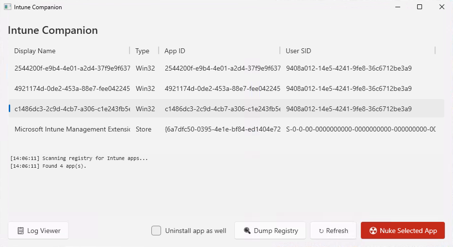
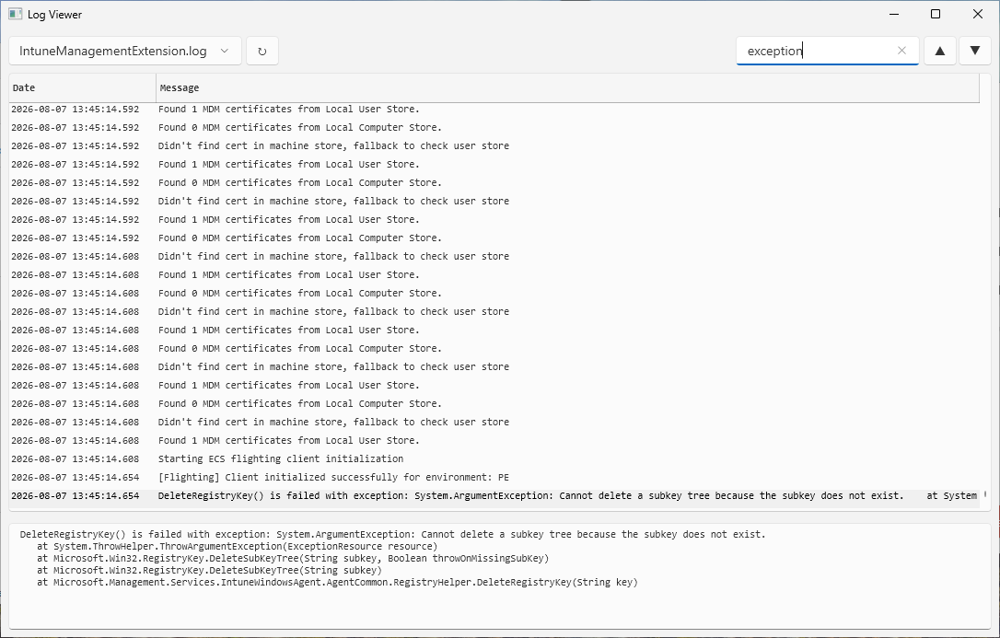

# Intune Companion

A companion app that helps troubleshoot Intune app deployments.

## Features

### Nuke / Purge an app

When Intune deploys an app, it tracks installation state across several registry locations (reporting data, Win32Apps entries, Sidecar policies, GRS hashes, operational state, etc.). If an app gets stuck or you need to force a reinstall, manually cleaning all of these is tedious and error-prone.

The **Nuke** feature removes all registry traces of a selected app in one click — deleting its entries from the reporting path, Win32Apps cache, SideCarPolicies, operational state, GRS keys, and (for Store/LOB apps) the EnterpriseDesktopAppManagement MSI keys. Once purged, the Intune Management Extension no longer considers the app as installed/tracked, so it will re-evaluate and reinstall it on the next sync cycle.

> **Important:** This tool only clears Intune's tracking state — it does **not** uninstall the application itself. You should manually uninstall the affected app (e.g., via Apps & Features / Programs and Features) before or after nuking, so that Intune's detection logic correctly sees the app as missing and triggers a fresh install.

The original PowerShell script this feature is based on is included as [`NukeIntuneApp.ps1`](NukeIntuneApp.ps1). You can run it standalone:

```powershell
.\NukeIntuneApp.ps1 -AppId "your-app-guid-here"
```

### Log Viewer

View the Intune Management Extension logs (`C:\ProgramData\Microsoft\IntuneManagementExtension\Logs`) in a structured, formatted way — making it much easier to diagnose deployment issues compared to reading the raw log files.

## Source Material & References

- [Force Company Portal App Repair/Reinstall by Intune Management Extension](https://danzi.blog/force-company-portal-app-repair-reinstall-by-intune-management-extension/)
- [Retry Failed Win32App Installation – GRS Manager](https://call4cloud.nl/retry-failed-win32app-installation/?ref=danzi.blog#14_GRS_Manager)

## Screenshots




